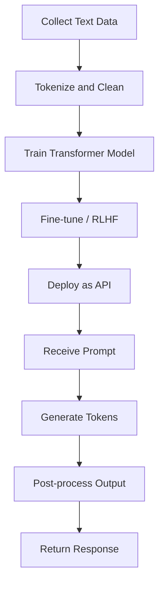

# What is an LLM

| | |
|:--|:--|
| **Module** | 1. LLM Fundamentals |
| **Topic** | 1 |
| **Code** | [code/example.py](./code/example.py) |
| **Video script** | [video/script.md](./video/script.md) |

> An LLM (Large Language Model) is a neural network trained on massive text data to predict and generate human‑like language.

---

## Fundamentals

## What is an LLM?

- **Large Language Model (LLM)**: a deep‑learning model, usually a transformer, that learns statistical patterns of language from billions of words.
- **Training objective**: predict the next token (word piece) given the preceding context. By minimizing prediction error, the model internalizes grammar, facts, and reasoning abilities.
- **Scale matters**: more parameters and more data generally improve fluency and knowledge breadth, which is why they are called *large*.
- **Inference**: after training, you feed a prompt and the model samples tokens one‑by‑one, producing coherent text.
- **Prompt engineering**: shaping the input (instructions, examples) to guide the model’s output without changing the model itself.
- **Safety layers**: filters, reinforcement‑learning from human feedback (RLHF), and other post‑processing steps keep outputs appropriate.

LLMs power chat assistants, code generators, document summarizers, and many other AI‑driven products.


---

## Workflow



---

## Example

### Real‑life Example: Customer Support Chatbot
1. **Collect data**: Gather past support tickets and FAQs.
2. **Preprocess**: Clean text, split into prompts and responses, and tokenize.
3. **Fine‑tune**: Start from a base LLM (e.g., GPT‑3) and train on the support data so the model learns company‑specific language.
4. **Deploy**: Host the fine‑tuned model behind an HTTP endpoint.
5. **Run**: When a user asks a question, send the query to the endpoint, the model generates a helpful answer, and the system returns it to the user.
This pipeline lets a business provide instant, accurate help without writing rule‑based scripts.

---

## Video

**Watch:** [Open video](https://github.com/nomancsediu/AI-Engineering-Roadmap/releases/tag/video-1-1)

**Scenes**

1. What is an LLM?
2. Training Basics
3. From Training to Inference
4. Prompt Engineering
5. LLMs in Products

Full narration: [video/script.md](./video/script.md)

---

## Code

```python
# pip install openai
import os, json
from openai import OpenAI

# Read API key from environment
api_key = os.getenv("OPENAI_API_KEY")
client = OpenAI(api_key=api_key)

prompt = "Explain the benefits of using LLMs in customer support."
response = client.chat.completions.create(
    model="gpt-3.5-turbo",
    messages=[{"role": "user", "content": prompt}],
    max_tokens=150,
    temperature=0.7,
)

print("Assistant:", response.choices[0].message.content.strip())
```

File: [code/example.py](./code/example.py)

---

## Key Takeaways

- LLMs are transformer models trained to predict the next token from massive text corpora.
- Scale (parameters + data) drives fluency and knowledge, enabling diverse applications.
- Prompt engineering and fine‑tuning let you adapt a generic LLM to specific tasks.

---

## Interview Questions

**Q1. What does the term 'large' refer to in LLM?**

It refers to both the number of model parameters—often billions—and the volume of training data, which together give the model its broad language capabilities.

**Q2. How does an LLM generate text?**

During inference it receives a prompt, computes probabilities for the next token, samples one token, appends it to the prompt, and repeats until a stop condition is met.

**Q3. What is prompt engineering?**

Prompt engineering is the practice of designing input text—using instructions, examples, or formatting—to guide the LLM’s output without modifying the model itself.

**Q4. Why might you fine‑tune an LLM?**

Fine‑tuning adapts a general‑purpose LLM to a specific domain, improving relevance, style, and safety for tasks like customer support or legal drafting.

**Q5. Name two safety techniques applied to LLM outputs.**

Common techniques include post‑processing filters that block harmful content and reinforcement learning from human feedback (RLHF) that aligns the model with desired behavior.

---

> AI-generated study note. Verify important details with official documentation.
