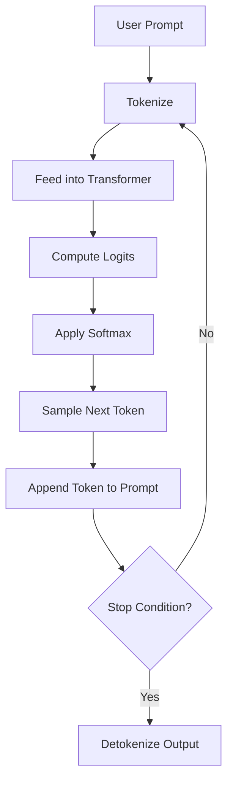

# How LLMs generate text

| | |
|:--|:--|
| **Module** | 1. LLM Fundamentals |
| **Topic** | 2 |
| **Code** | [code/example.py](./code/example.py) |
| **Video script** | [video/script.md](./video/script.md) |

> LLMs generate text by predicting the next token based on the probability distribution conditioned on all previous tokens.

---

## Fundamentals

LLMs (Large Language Models) are trained on massive text corpora to learn **token probabilities**. When generating, the model receives a prompt, tokenizes it, and feeds the token IDs into the transformer network. Each layer applies **self‑attention** to capture context, producing a hidden state for every token. The final layer maps these states to a **logits vector** over the vocabulary. A **softmax** turns logits into a probability distribution, from which the next token is sampled (e.g., greedy, top‑k, nucleus). The chosen token is appended to the prompt, re‑tokenized, and the process repeats until a stop condition (max length, EOS token) is met.

Key steps:
- **Tokenization**: split text into sub‑word units.
- **Context window**: the model can attend to a fixed number of recent tokens.
- **Sampling strategy**: determines randomness vs. determinism.
- **Temperature**: scales logits to control creativity.

In real AI products, this pipeline powers chat assistants, code completion tools, and content generation services, turning user input into coherent, context‑aware responses.

---

## Workflow



---

## Example

### Real‑life example: Generating a product description
1. **Prompt**: "Write a 50‑word description for a waterproof Bluetooth speaker."
2. **Tokenize** the prompt into sub‑words.
3. **Feed** tokens to the LLM; the model returns logits for the next token.
4. **Apply softmax** and **sample** the most likely token (e.g., "The").
5. **Append** "The" to the prompt and repeat steps 2‑4.
6. Continue until the model emits an **EOS** token or reaches 50 words.
7. **Detokenize** the token sequence to produce the final human‑readable description.
The result is a ready‑to‑use marketing copy generated automatically.

---

## Video

**Watch:** [Open video](https://github.com/nomancsediu/AI-Engineering-Roadmap/releases/tag/video-1-2)

**Scenes**

1. Intro to Text Generation
2. From Prompt to Tokens
3. Transformer Forward Pass
4. Logits to Words
5. Loop Until Completion
6. Real‑World Use Cases

Full narration: [video/script.md](./video/script.md)

---

## Code

```python
import os
import json
import requests

# pip install requests
# Set your OpenAI API key in the environment variable OPENAI_API_KEY
API_KEY = os.getenv('OPENAI_API_KEY')
if not API_KEY:
    raise EnvironmentError('OPENAI_API_KEY not set')

endpoint = 'https://api.openai.com/v1/chat/completions'
headers = {
    'Content-Type': 'application/json',
    'Authorization': f'Bearer {API_KEY}'
}

prompt = "Write a concise 30‑word product description for a waterproof Bluetooth speaker."
payload = {
    'model': 'gpt-3.5-turbo',
    'messages': [{'role': 'user', 'content': prompt}],
    'max_tokens': 60,
    'temperature': 0.7,
    'n': 1
}

response = requests.post(endpoint, headers=headers, data=json.dumps(payload))
response.raise_for_status()
result = response.json()
generated_text = result['choices'][0]['message']['content']
print('Generated description:')
print(generated_text.strip())
```

File: [code/example.py](./code/example.py)

---

## Key Takeaways

- LLMs generate text token‑by‑token using probability distributions.
- Sampling strategies (greedy, top‑k, nucleus) control randomness and creativity.
- The same generation loop underlies chatbots, code assistants, and content generators.

---

## Interview Questions

**Q1. What does it mean that an LLM generates text token by token?**

The model predicts the next token based on all previous tokens, adds it to the sequence, and repeats. Each step uses the same forward pass, turning logits into a probability distribution.

**Q2. How does temperature affect text generation?**

Temperature scales the logits before softmax. A low temperature (<1) makes the distribution sharper, yielding more deterministic output; a high temperature (>1) flattens it, increasing randomness.

**Q3. What is top‑k sampling and why use it?**

Top‑k keeps only the k most probable tokens and renormalizes their probabilities. It prevents low‑probability junk tokens while still allowing some variety.

**Q4. Why is a context window important?**

The model can only attend to a fixed number of recent tokens. Information outside that window is invisible, so prompts must be concise or use techniques like sliding windows.

**Q5. Give an example of a real product that relies on this generation loop.**

ChatGPT uses the same token‑by‑token loop to turn user messages into coherent replies, applying temperature and top‑p settings to balance relevance and creativity.

---

> AI-generated study note. Verify important details with official documentation.
