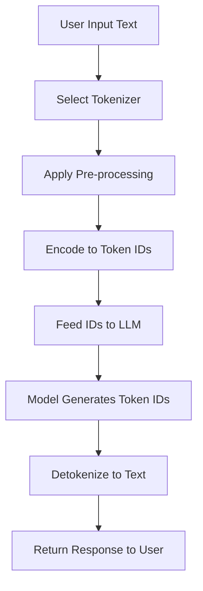

# Tokenization

| | |
|:--|:--|
| **Module** | 1. LLM Fundamentals |
| **Topic** | 3 |
| **Code** | [code/example.py](./code/example.py) |
| **Video script** | [video/script.md](./video/script.md) |

> Tokenization is the process of converting raw text into discrete units (tokens) that a language model can understand and process.

---

## Fundamentals

Tokenization is the first step in any LLM pipeline. **Tokens** are the smallest pieces of text the model works with – they can be characters, sub‑words, or whole words depending on the tokenizer type.

- **Whitespace tokenizers** split on spaces; simple but wasteful for large vocabularies.
- **Byte‑Pair Encoding (BPE)** builds a vocabulary of frequent sub‑word units, balancing vocabulary size and coverage.
- **WordPiece** and **Unigram** are variations used by models like BERT and SentencePiece.

The tokenizer must be **deterministic**: the same input string always yields the same token IDs, which is crucial for reproducibility and caching. It also handles **special tokens** such as ``[CLS]`` for classification, ``[SEP]`` for separating sequences, and ``[PAD]`` for batching.

During inference, the raw user query is passed through the tokenizer, producing an integer array that the model consumes. After generation, the model’s output IDs are passed back through the **detokenizer** to produce readable text.

Real AI products use tokenization to limit request size, manage cost (tokens are billed), and ensure consistent behavior across languages and domains.

---

## Workflow



---

## Example

### Real‑life Example: Summarizing a Customer Support Email
1. **Input**: "I received my order yesterday but the package was damaged and the item is missing. Please help."
2. **Tokenizer**: Using OpenAI's `tiktoken` BPE tokenizer, the sentence is split into tokens like `[I, received, my, order, yesterday, but, the, package, was, damaged, ...]` and each token gets an integer ID.
3. **Model Call**: The list of IDs is sent to `gpt-3.5-turbo` with a prompt asking for a short summary.
4. **Output IDs**: The model returns IDs representing the summary text.
5. **Detokenizer**: Convert IDs back to "Order arrived damaged, item missing – request assistance."
6. **Result**: The system sends this concise summary to the support agent.
This flow shows how tokenization bridges raw user text and model inference.

---

## Video

**Watch:** [Open video](https://github.com/nomancsediu/AI-Engineering-Roadmap/releases/tag/video-1-3)

**Scenes**

1. What is Tokenization?
2. Types of Tokenizers
3. Special Tokens
4. Tokenization in an API Call
5. Practical Tips

Full narration: [video/script.md](./video/script.md)

---

## Code

```python
# pip install tiktoken openai
import os, json
import tiktoken  # OpenAI's tokenizer library
import openai

# Load API key from environment
openai.api_key = os.getenv("OPENAI_API_KEY")

# Choose the same tokenizer used by gpt-3.5-turbo
enc = tiktoken.encoding_for_model("gpt-3.5-turbo")

text = "I received my order yesterday but the package was damaged and the item is missing. Please help."
# Encode to token IDs
token_ids = enc.encode(text)
print("Token IDs:", token_ids)
print("Number of tokens:", len(token_ids))

# Simple summarization prompt
prompt = f"Summarize in one sentence: {text}"
prompt_ids = enc.encode(prompt)

response = openai.ChatCompletion.create(
    model="gpt-3.5-turbo",
    messages=[{"role": "user", "content": prompt}],
    max_tokens=30,
    temperature=0.2,
)
# Extract generated text
summary = response.choices[0].message.content.strip()
print("Summary:", summary)

# Detokenize the model's raw token IDs (optional demonstration)
# Here we just re‑encode the summary to show round‑trip
summary_ids = enc.encode(summary)
print("Round‑trip IDs match?", summary_ids == enc.encode(summary))
```

File: [code/example.py](./code/example.py)

---

## Mini Project: Email Summarizer Service

**Goal:** Build a Flask API that receives a customer email, tokenizes it, calls an LLM to summarize, and returns the summary.

**Steps**

1. Set up a Flask endpoint that accepts JSON with a 'email' field.
2. Use tiktoken to count tokens and reject overly long inputs.
3. Call OpenAI's chat completion with a summarization prompt.
4. Return the summary and token usage in the response.

**Files to create:** `app.py`, `requirements.txt`, `README.md`

**Stretch:** Add caching of tokenized prompts to reduce repeated tokenization for identical emails.

Build this yourself and commit it inside the `project/` folder of this topic.

---

## Key Takeaways

- Tokenization converts text into model‑readable integer IDs.
- BPE‑based tokenizers balance vocabulary size and language coverage.
- Token counts affect cost, latency, and prompt design.

---

## Interview Questions

**Q1. Why do LLMs operate on tokens instead of raw characters?**

Tokens provide a compact, language‑aware representation that reduces sequence length, improves training efficiency, and lets the model learn meaningful sub‑word patterns.

**Q2. What is Byte‑Pair Encoding and how does it differ from a word‑level tokenizer?**

BPE starts with a character vocabulary and iteratively merges the most frequent adjacent pairs, creating sub‑word units. Unlike word‑level tokenizers, BPE can represent rare or unknown words with a few known sub‑words, keeping the vocabulary size manageable.

**Q3. How do special tokens like [CLS] and [PAD] affect model input?**

[CLS] often marks the start of a sequence for classification tasks, while [PAD] fills shorter sequences to a uniform length for batch processing. Both are learned embeddings that give the model positional cues.

**Q4. What practical steps can you take to control token‑related costs when using an LLM API?**

Count tokens before sending a request, truncate or summarize long inputs, use concise prompts, and monitor usage metrics provided in the API response.

**Q5. If you receive a tokenization error from an API, what are common causes and fixes?**

Common causes include unsupported characters, exceeding the model’s maximum token limit, or mismatched tokenizer versions. Fixes involve cleaning the input, splitting into smaller chunks, or ensuring you use the same tokenizer as the model.

---

> AI-generated study note. Verify important details with official documentation.
