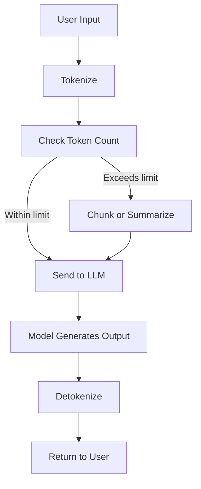

# Context windows

| | |
|:--|:--|
| **Module** | 1. LLM Fundamentals |
| **Topic** | 4 |
| **Code** | [code/example.py](./code/example.py) |
| **Video script** | [video/script.md](./video/script.md) |

> A context window is the fixed-size chunk of text that an LLM can attend to at one time.

---

## Fundamentals

## What is a Context Window?
- **Context window** (or context length) is the maximum number of tokens an LLM can process in a single forward pass.
- Tokens are the basic units the model sees – words, sub‑words, or characters depending on the tokenizer.
- The window is a sliding frame: when the input exceeds the limit, older tokens are dropped or summarized.

## Why it matters
- **Prompt engineering** must fit the most important information inside the window; otherwise the model forgets earlier parts.
- Larger windows allow richer, multi‑turn conversations, longer documents, or more detailed code snippets.
- The window size is baked into the model architecture (e.g., GPT‑3.5‑turbo ≈ 4 k tokens, GPT‑4‑32k ≈ 32 k tokens).

## Practical tips
- Count tokens, not characters. Rough rule: 1 token ≈ 4 characters of English text.
- Use summarization or retrieval‑augmented generation (RAG) to keep relevant context within the window.
- Chunk long inputs into overlapping slices to preserve continuity.

**Real‑world use**: Context windows drive how chat assistants store conversation history, how document‑search tools retrieve relevant passages, and how code‑completion models keep the surrounding code in view.


---

## Workflow



---

## Example

### Real‑life example: Summarizing a 10‑page report
1. **Load** the PDF and extract raw text.
2. **Tokenize** the text and count tokens; suppose the report yields 12 k tokens.
3. The chosen model (GPT‑3.5‑turbo) only supports 4 k tokens, so we **split** the report into three overlapping 4 k‑token chunks.
4. For each chunk we **prompt** the model: "Summarize the following section in 2 sentences."
5. Collect the three short summaries and **prompt** the model again with those summaries (now well under the limit) asking for a final concise abstract.
6. Return the final abstract to the user.
This workflow keeps the whole document in view while respecting the context window.


---

## Video

**Watch:** [Open video](https://github.com/nomancsediu/AI-Engineering-Roadmap/releases/tag/video-1-4)

**Scenes**

1. Introducing Context Windows
2. Token Counting Basics
3. When Input Exceeds the Window
4. Practical Prompt Design
5. Real Product Examples

Full narration: [video/script.md](./video/script.md)

---

## Code

```python
# pip install tiktoken openai
import os, json
import tiktoken  # token counting library from OpenAI
import openai

# Load API key from environment
openai.api_key = os.getenv("OPENAI_API_KEY")

def count_tokens(text, model="gpt-3.5-turbo"):
    enc = tiktoken.encoding_for_model(model)
    return len(enc.encode(text))

def chunk_text(text, max_tokens=4000, overlap=200):
    enc = tiktoken.encoding_for_model("gpt-3.5-turbo")
    tokens = enc.encode(text)
    chunks = []
    i = 0
    while i < len(tokens):
        end = i + max_tokens
        chunk = tokens[i:end]
        chunks.append(enc.decode(chunk))
        i = end - overlap  # step back for overlap
    return chunks

def summarize_chunk(chunk):
    response = openai.ChatCompletion.create(
        model="gpt-3.5-turbo",
        messages=[{"role": "user", "content": f"Summarize the following text in two sentences:\n\n{chunk}"}]
    )
    return response.choices[0].message.content.strip()

# Example usage
with open("report.txt", "r", encoding="utf-8") as f:
    long_text = f.read()

if count_tokens(long_text) > 4000:
    parts = chunk_text(long_text)
    summaries = [summarize_chunk(p) for p in parts]
    final_prompt = "Combine these summaries into a single short abstract:\n" + "\n".join(summaries)
    final = summarize_chunk(final_prompt)
else:
    final = summarize_chunk(long_text)

print("Final abstract:", final)
```

File: [code/example.py](./code/example.py)

---

## Key Takeaways

- Context windows limit how many tokens a model can see at once.
- Always count tokens and trim or chunk inputs to stay within the limit.
- Use summarization or retrieval‑augmented techniques to handle longer texts.

---

## Interview Questions

**Q1. What is a context window and why does it matter?**

A context window is the maximum number of tokens an LLM can process in one request. It matters because any information outside that window is invisible to the model, so prompts must be sized or engineered accordingly.

**Q2. How can you estimate token count without a library?**

A rough rule is that one English token equals about four characters, including spaces and punctuation. Multiplying the character count by 0.25 gives a quick estimate.

**Q3. What strategies help when your input exceeds the model's context limit?**

Common strategies are chunking the input into overlapping slices, summarizing earlier parts, or using retrieval‑augmented generation to fetch only the most relevant passages.

**Q4. Why might you keep an overlap between chunks?**

Overlap preserves continuity across chunk boundaries, ensuring that the model sees some shared context and can maintain coherence when processing each slice.

**Q5. Give an example of a real product that relies heavily on context windows.**

Chat assistants like ChatGPT store recent conversation turns within the window so the model can generate context‑aware replies; older turns are either omitted or summarized.

---

> AI-generated study note. Verify important details with official documentation.
