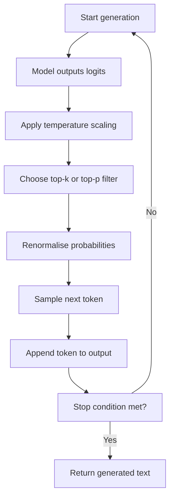

# Sampling: temperature, top-p, top-k

| | |
|:--|:--|
| **Module** | 1. LLM Fundamentals |
| **Topic** | 5 |
| **Code** | [code/example.py](./code/example.py) |
| **Video script** | [video/script.md](./video/script.md) |

> Sampling controls how an LLM picks the next token by adjusting randomness with temperature, top‑p, and top‑k.

---

## Fundamentals

When a language model generates text it produces a probability distribution over the next token. **Temperature** scales the logits before softmax; a low temperature (<1) makes the distribution sharper (more deterministic) while a high temperature (>1) flattens it (more random). **Top‑k** truncates the distribution to the *k* most likely tokens and renormalises, discarding the rest. **Top‑p** (nucleus sampling) keeps the smallest set of tokens whose cumulative probability exceeds *p* (e.g., 0.9) and renormalises. These techniques can be combined: first apply top‑k or top‑p to limit the candidate set, then use temperature to tune randomness within that set. The result is a balance between creativity and coherence. In practice, developers tweak these parameters to get responses that are either precise (low temperature, small k) or more varied and imaginative (higher temperature, larger p). Real AI products such as chat assistants, code generators, and story‑writing tools expose these knobs to let users customise output style.

---

## Workflow



---

## Example

### Real‑life example: generating a product description
1. Call the LLM with a prompt like *"Write a 50‑word description for a waterproof Bluetooth speaker."*
2. Set **temperature=0.7** to allow some creativity.
3. Use **top‑p=0.9** so the model only considers tokens that together make up 90% of probability mass.
4. Optionally set **top‑k=50** to cap the candidate list at 50 tokens.
5. The model samples token by token until it reaches the length limit or an end‑of‑sentence token.
6. The final string is returned and displayed to the user.
This workflow is typical in e‑commerce platforms that auto‑generate marketing copy.

---

## Video

**Watch:** [Open video](https://github.com/nomancsediu/AI-Engineering-Roadmap/releases/tag/video-1-5)

**Scenes**

1. Why sampling matters
2. Temperature explained
3. Top‑k and top‑p basics
4. Combining the knobs
5. Real product demo

Full narration: [video/script.md](./video/script.md)

---

## Code

```python
import os, json, random
import openai  # pip install openai

# Read API key from environment
openai.api_key = os.getenv('OPENAI_API_KEY')

prompt = "Write a friendly 30‑word welcome message for new users of a fitness app."

response = openai.ChatCompletion.create(
    model="gpt-3.5-turbo",
    messages=[{"role": "user", "content": prompt}],
    temperature=0.8,   # creativity
    top_p=0.9,         # nucleus sampling
    # top_k is not directly exposed in OpenAI API; some providers support it
    max_tokens=60,
    n=1,
    stop=None
)

generated = response['choices'][0]['message']['content']
print("Generated message:")
print(generated)

# Simple function to experiment with parameters
def generate(text, temp=1.0, p=1.0):
    r = openai.ChatCompletion.create(
        model="gpt-3.5-turbo",
        messages=[{"role": "user", "content": text}],
        temperature=temp,
        top_p=p,
        max_tokens=80
    )
    return r['choices'][0]['message']['content']

print("--- Variation with low temperature ---")
print(generate(prompt, temp=0.2, p=0.95))
print("--- Variation with higher temperature ---")
print(generate(prompt, temp=1.2, p=0.9))
```

File: [code/example.py](./code/example.py)

---

## Key Takeaways

- Temperature adjusts randomness; lower values make output deterministic.
- Top‑k limits candidates to the k most likely tokens; top‑p keeps tokens covering a probability mass p.
- Combining these knobs lets you trade off creativity vs reliability in production LLM apps.

---

## Interview Questions

**Q1. What does the temperature parameter control in LLM sampling?**

Temperature scales the model's logits before the softmax. A low temperature (<1) makes the distribution peaked, yielding more deterministic output, while a high temperature (>1) flattens it, increasing randomness.

**Q2. How does top‑k sampling differ from top‑p (nucleus) sampling?**

Top‑k always keeps exactly k highest‑probability tokens, discarding the rest. Top‑p keeps the smallest set of tokens whose cumulative probability exceeds a threshold p, so the size of the set varies per step.

**Q3. Why might you combine temperature with top‑p?**

Top‑p first restricts the candidate pool to plausible tokens, then temperature controls how random the final choice is within that pool, giving fine‑grained control over creativity and safety.

**Q4. When would you set temperature to 0?**

Setting temperature to 0 forces greedy decoding – the model always picks the highest‑probability token – which is useful for deterministic tasks like code generation or factual QA.

**Q5. What practical impact does adjusting top‑k have on response latency?**

A smaller top‑k reduces the number of tokens the model must consider, slightly lowering computation and latency, while a larger k can increase diversity but may add overhead.

---

> AI-generated study note. Verify important details with official documentation.
