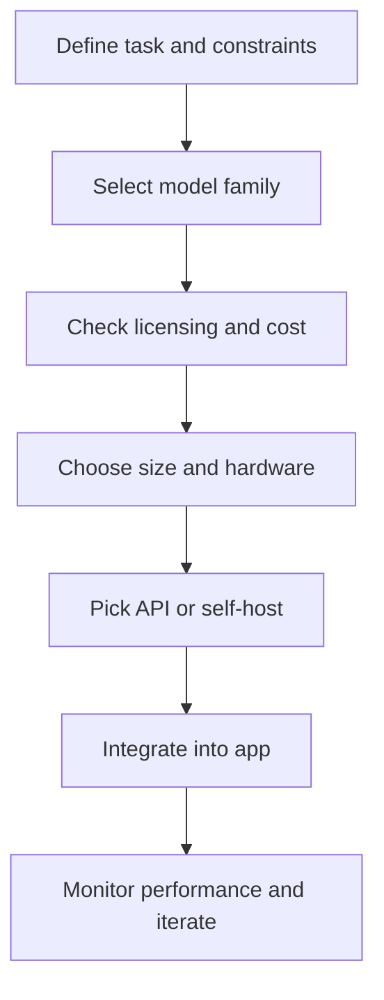

# Model types and how to choose one

| | |
|:--|:--|
| **Module** | 1. LLM Fundamentals |
| **Topic** | 7 |
| **Code** | [code/example.py](./code/example.py) |
| **Video script** | [video/script.md](./video/script.md) |

> Choosing an LLM involves understanding model families, sizes, licensing, and deployment constraints to match your application’s needs.

---

## Fundamentals

## Model Types
- **Base models** – raw LLMs trained on large text corpora (e.g., Llama‑2, Mistral). They provide the core language ability and are usually open‑source.
- **Instruction‑tuned models** – base models further fine‑tuned to follow human instructions (e.g., ChatGPT, Claude). They are better at conversational tasks.
- **Domain‑adapted models** – instruction‑tuned models that have been specialized on a specific field such as legal, medical, or code (e.g., CodeLlama, BioGPT).
- **Embedding models** – smaller networks that output vector representations for similarity search, retrieval‑augmented generation, or clustering (e.g., OpenAI text‑embedding‑ada‑002).

## Choosing Criteria
1. **Task type** – Generation (chat, content), classification, retrieval, or code assistance. Use generation‑oriented models for free‑form text; use embedding models for similarity.
2. **Model size vs latency** – Larger models (70B+) give higher quality but need GPU or paid API; 7‑13B models run on a single consumer GPU.
3. **Licensing** – Open‑source models let you host anywhere; commercial APIs have usage limits but simplify scaling.
4. **Data privacy** – On‑prem models keep data in‑house; cloud APIs may require data sharing agreements.
5. **Cost** – Estimate token price for API models or GPU hourly cost for self‑hosted models.

## Practical Decision Tree
- Need **high‑quality chat** and can afford API cost → pick ChatGPT‑4 or Claude.
- Need **custom domain knowledge** and control data → fine‑tune an open‑source base model.
- Need **fast, cheap inference** on a laptop → use a 7B open‑source model with quantization.
- Need **vector search** → use a dedicated embedding model.

**Real‑world use**: Customer‑support bots often combine an instruction‑tuned chat model for response generation with an embedding model for retrieving relevant knowledge‑base articles.

---

## Workflow



---

## Example

### Real‑life Example: FAQ Bot for an E‑commerce Site
1. **Identify need** – The site wants a bot that answers product questions instantly.
2. **Choose model** – Use an instruction‑tuned open‑source model (Llama‑2‑Chat 13B) for generation and OpenAI's `text-embedding-ada-002` for retrieval.
3. **Prepare data** – Export the FAQ list, embed each question with the embedding model, store vectors in a Pinecone index.
4. **Build pipeline** – When a user asks a question, embed the query, fetch the top‑3 similar FAQs, concatenate them with the user query, and send the prompt to the chat model.
5. **Deploy** – Host the chat model on an AWS EC2 GPU instance, expose a FastAPI endpoint, and secure the OpenAI key via environment variable.
6. **Iterate** – Log unanswered queries, fine‑tune the model on those examples, and redeploy.
This flow lets the bot answer both known FAQs and novel questions with coherent language.

---

## Video

**Watch:** [Open video](https://github.com/nomancsediu/AI-Engineering-Roadmap/releases/tag/video-1-7)

**Scenes**

1. Intro to Model Types
2. Sizing and Latency
3. Licensing & Privacy
4. Embedding Models
5. Decision Flow in Action
6. Wrap‑up & Tips

Full narration: [video/script.md](./video/script.md)

---

## Code

```python
# pip install openai pinecone-client torch transformers
import os, json
from openai import OpenAI
import pinecone
from transformers import AutoModelForCausalLM, AutoTokenizer

# Load API keys from environment
openai_api_key = os.getenv("OPENAI_API_KEY")
pinecone_api_key = os.getenv("PINECONE_API_KEY")

# Initialize clients
client = OpenAI(api_key=openai_api_key)
pinecone.init(api_key=pinecone_api_key, environment="us-west1-gcp")
index = pinecone.Index("faq-index")

# Load a small instruction‑tuned model locally
model_name = "meta-llama/Llama-2-7b-chat-hf"
tokenizer = AutoTokenizer.from_pretrained(model_name)
model = AutoModelForCausalLM.from_pretrained(model_name, device_map="auto")

def embed_text(text):
    # Use OpenAI embedding endpoint
    resp = client.embeddings.create(model="text-embedding-ada-002", input=text)
    return resp.data[0].embedding

def retrieve_faq(query, top_k=3):
    vec = embed_text(query)
    results = index.query(vector=vec, top_k=top_k, include_metadata=True)
    return [r.metadata["answer"] for r in results.matches]

def generate_answer(query, context):
    prompt = f"You are a helpful e‑commerce assistant. Use the following context to answer the question.\nContext: {context}\nQuestion: {query}\nAnswer:"
    inputs = tokenizer(prompt, return_tensors="pt").to(model.device)
    output = model.generate(**inputs, max_new_tokens=150)
    return tokenizer.decode(output[0], skip_special_tokens=True)

# Example usage
user_question = "What is the return policy for electronics?"
faq_context = " ".join(retrieve_faq(user_question))
answer = generate_answer(user_question, faq_context)
print(answer)
```

File: [code/example.py](./code/example.py)

---

## Key Takeaways

- Match model family to task: generation vs retrieval.
- Balance size, latency, cost, and privacy when picking a model.
- Use a decision flow to quickly narrow down the best LLM for your product.

---

## Interview Questions

**Q1. What are the main differences between a base LLM and an instruction‑tuned LLM?**

A base LLM is trained only on raw text and knows language patterns, while an instruction‑tuned LLM has an extra fine‑tuning step on prompts and responses, making it better at following user instructions and producing conversational output.

**Q2. When would you choose an embedding model over a generative LLM?**

Embedding models are ideal when you need to compare text similarity, perform semantic search, or retrieve relevant documents. They produce fixed‑size vectors rather than free‑form text, which is cheaper and faster for large‑scale retrieval tasks.

**Q3. How does licensing affect your deployment choice?**

Open‑source licenses let you run models on‑premise, giving full control over data and cost, whereas commercial APIs impose usage limits, data‑sharing policies, and per‑token pricing but remove the operational burden of hosting.

**Q4. What factors determine the appropriate model size for a real‑time chatbot?**

Key factors are latency requirements, available hardware (CPU vs GPU), expected traffic volume, and budget. Smaller models (7‑13B) run on a single GPU with low latency, while larger models may need multi‑GPU clusters and incur higher cost.

**Q5. Explain a simple workflow to add domain knowledge to a generic chat model.**

First, collect domain‑specific documents, embed them with an embedding model, and store vectors in a vector database. At query time, retrieve the most relevant snippets, prepend them to the user prompt, and send the combined prompt to the generic chat model, which then generates a domain‑aware response.

---

> AI-generated study note. Verify important details with official documentation.
