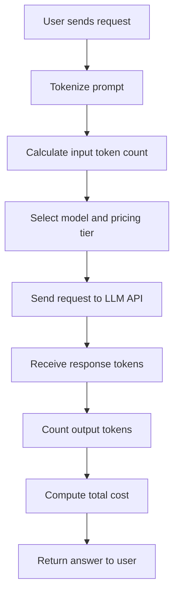

# Token pricing and cost

| | |
|:--|:--|
| **Module** | 1. LLM Fundamentals |
| **Topic** | 8 |
| **Code** | [code/example.py](./code/example.py) |
| **Video script** | [video/script.md](./video/script.md) |

> Token pricing and cost refer to how LLM providers charge based on the number of input and output tokens processed by the model.

---

## Fundamentals

LLMs work with **tokens**, which are chunks of text such as words or sub‑words. Every request to an API consumes tokens for the prompt you send (**input tokens**) and for the text the model returns (**output tokens**). Providers publish a **price per 1,000 tokens** for each model tier. To estimate cost you multiply the total tokens by the rate.

- **Counting tokens**: Most providers give a tokenizer library (e.g., `tiktoken` for OpenAI) that converts a string to token IDs. The length of this list is the token count.
- **Pricing tiers**: Larger models (GPT‑4) cost more per token than smaller ones (GPT‑3.5). Some providers also charge differently for prompt vs. completion tokens.
- **Batching**: Sending many short prompts together can reduce overhead, but the total token count still drives cost.
- **Rate limits and quotas**: APIs often enforce a maximum tokens per minute; exceeding it can add latency or extra fees.

Understanding token pricing helps you design prompts that are concise, choose the right model, and forecast monthly spend. Real AI products—like chat assistants, summarizers, or code generators—use token cost calculations to keep pricing transparent for users and to stay within budget.


---

## Workflow



---

## Example

### Real‑life example: Summarizing a news article
1. **Load the article** (2,500 words ≈ 3,500 tokens).
2. **Tokenize** the article using `tiktoken` to get the exact token count.
3. **Calculate cost**: If using GPT‑3.5 at $0.002 per 1k input tokens, the prompt costs 3.5 × $0.002 = $0.007.
4. **Send the prompt**: "Summarize the following article:" plus the article text.
5. **Receive output**: The model returns a 150‑token summary.
6. **Add output cost**: 0.15 × $0.002 = $0.0003.
7. **Total cost**: $0.0073 for one summarization request.
This step‑by‑step shows how token counting directly translates to dollars.


---

## Video

**Watch:** [Open video](https://github.com/nomancsediu/AI-Engineering-Roadmap/releases/tag/video-1-8)

**Scenes**

1. What are tokens?
2. How providers price tokens
3. Counting tokens in code
4. Estimating cost for a request
5. Cost‑aware design tips

Full narration: [video/script.md](./video/script.md)

---

## Code

```python
# pip install openai tiktoken
import os, json
import openai
import tiktoken

# Load API key from environment
openai.api_key = os.getenv("OPENAI_API_KEY")

# Example text to summarize
article = """Your long article text goes here..."""

# Choose model and pricing (example rates)
model = "gpt-3.5-turbo"
price_per_1k_input = 0.002   # USD
price_per_1k_output = 0.002  # USD

# Tokenize input
enc = tiktoken.encoding_for_model(model)
input_tokens = len(enc.encode(article))

# Build prompt
prompt = f"Summarize the following article in 2 sentences:\n\n{article}"
prompt_tokens = len(enc.encode(prompt))

# Call the API
response = openai.ChatCompletion.create(
    model=model,
    messages=[{"role": "user", "content": prompt}],
    max_tokens=150
)

# Count output tokens
output_text = response.choices[0].message.content
output_tokens = len(enc.encode(output_text))

# Compute cost
cost = (prompt_tokens / 1000) * price_per_1k_input + (output_tokens / 1000) * price_per_1k_output

print(json.dumps({
    "prompt_tokens": prompt_tokens,
    "output_tokens": output_tokens,
    "total_cost_usd": round(cost, 6),
    "summary": output_text
}, indent=2))
```

File: [code/example.py](./code/example.py)

---

## Mini Project: Budget‑aware Chatbot

**Goal:** Build a simple web chatbot that shows estimated cost before sending each message.

**Steps**

1. Set up a Flask app with a single chat endpoint.
2. Integrate OpenAI API and tiktoken for token counting.
3. Calculate and display cost for each user message and model reply.
4. Store cumulative daily spend in a JSON file.
5. Add a warning when projected spend exceeds a threshold.

**Files to create:** `app.py`, `templates/index.html`, `cost_tracker.json`

**Stretch:** Add support for multiple models and let the user pick a cheaper model when the budget is low.

Build this yourself and commit it inside the `project/` folder of this topic.

---

## Key Takeaways

- Tokens are the billable unit; both prompt and response count.
- Use the provider's tokenizer to get exact token counts.
- Cost = (input tokens + output tokens) ÷ 1000 × price per 1k tokens.

---

## Interview Questions

**Q1. How does an LLM provider charge for API usage?**

They charge per 1,000 tokens processed. Both the tokens you send (input) and the tokens the model returns (output) are counted, often with separate rates for different model tiers.

**Q2. Why is token counting more accurate than counting characters or words?**

Tokens reflect how the model actually processes text. A single word can become multiple tokens, especially for rare words, so token counts align with the model's compute cost.

**Q3. What tools can you use to count tokens for OpenAI models?**

OpenAI provides the `tiktoken` library, which includes model‑specific encodings. You encode a string and take the length of the resulting list.

**Q4. How can you reduce the cost of a production LLM service?**

Keep prompts concise, choose smaller or cheaper models when high fidelity isn’t needed, batch multiple requests, and implement usage caps or warnings.

**Q5. Explain how you would display the estimated cost to a user before sending a request.**

First tokenize the user’s prompt, compute input token cost, estimate output tokens (e.g., based on `max_tokens`), add both costs, and show the total in UI. The user can confirm or edit the prompt.

---

> AI-generated study note. Verify important details with official documentation.
